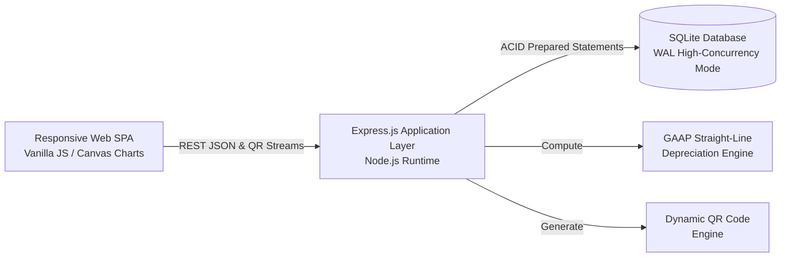

# AssetFlow Pro — Enterprise Office Asset Management System
> Modern, High-Performance Office Hardware & Digital Asset Management Platform with Real-Time GAAP Straight-Line Depreciation, Dynamic QR Tracking, and Custody Lifecycle Management.

[](https://nodejs.org/)
[-003B57?logo=sqlite)](https://sqlite.org/)
[-brightgreen)](#automated-testing)
[](#system-architecture)
[](#-authentication-portal)
[](LICENSE)

---

## View The Deployed Project here:
[Office Asset Managememt System](https://office-asset-management-system-ten.vercel.app/)

---

## 🌟 Key Features

- **Authentication & Sign-In Portal:** Secure entry gateway before dashboard access with PBKDF2 cryptographic hashing, role-based profiles (`IT Administrator`, `Asset Manager`, `Logistics Officer`, `Staff Member`), session tokens, and instant 1-click demo logins.
- **Asset Inventory Registry:** Complete CRUD operations for laptops, displays, workstations, servers, and office furniture with automated Asset Tag (`AST-YYYY-XXX`) and serial generation.
- **Chain of Custody (Check-out & Check-in):** Assign equipment to employees across departments with return date expectations and multi-grade physical condition inspection (`New`, `Excellent`, `Good`, `Fair`, `Damaged`).
- **GAAP / IAS 16 Straight-Line Depreciation Engine:** Automated financial carrying book value calculations, annual amortization, and remaining useful life indicators with mathematical bounds preventing book value from dipping below salvage value.
- **Dynamic QR Code Labeling:** Instant Base64 and direct streaming PNG QR codes (`/api/assets/:id/qr`) formatted for adhesive sticker printing.
- **Maintenance & Service Ticketing:** Complete ticketing workflow for hardware faults, priority tiers (`Low`, `Medium`, `High`, `Critical`), vendor tracking, and repair cost logging.
- **Executive KPI Dashboard:** Real-time summary cards, high-DPI HTML5 Canvas category donut chart, department allocation breakdown, and proactive 90-day warranty expiration alerts.
- **RFC 4180 CSV Export:** 1-click download of the complete asset register for financial reporting in Excel or Google Sheets.
- **Immutable Audit Trail:** Chronological transaction log recording every creation, assignment, inspection, and repair event.
- **Zero-Build Vanilla SPA:** Modern SaaS glassmorphic UI requiring zero bundlers (no Webpack/Vite overhead), ensuring instant startup and 100% offline reliability.

---

## 🏗️ System Architecture



---

## 🚀 Quick Start (Local Run)

### Prerequisites
- [Node.js](https://nodejs.org/) (v18.0.0 or higher)

### Installation & Launch
```bash
# 1. Navigate to project folder
cd office-asset-management

# 2. Install dependencies (takes ~3 seconds)
npm install

# 3. Run automated test suite
npm test

# 4. Start the server
npm start
```

Open your browser to:
```
http://localhost:3000
```
> **Note:** On first startup, the system automatically runs schema migrations and seeds **12 enterprise assets, 8 employees, 6 active allocations, maintenance history, and portal user accounts**.

---

## 🔐 Authentication Portal & Default Accounts

Before accessing the system, visitors are greeted with the secure **AssetFlow Authentication & Sign-In Portal**:

### 1-Click Demo Logins:
- ⚡ **IT Administrator (Full Access):**
  - **Email / Username:** `admin@company.com` or `admin`
  - **Password:** `admin123`
- 💼 **Asset Manager:**
  - **Email / Username:** `sarah.chen@company.com` or `sarah`
  - **Password:** `user123`

### Sign Up / Registration:
- Anyone can click the **Sign Up / Register** tab to create a new user profile with their choice of role (`IT Administrator`, `Asset Manager`, `Logistics Officer`, `Staff Member`), email, and password.
- Sign out anytime with 1-click using the **Sign Out** button in the sidebar footer or top navigation bar.

---

## 🧪 Automated Testing

AssetFlow Pro features an automated integration and unit test suite built with Node's native `node:test` runner.

```bash
npm test
```

### Test Coverage Highlights:
- **Suite 1:** Straight-Line Depreciation math, annual expense, book value caps, and multi-year schedule generation.
- **Suite 2:** Asset inventory CRUD, automatic tag assignment, and QR code streaming.
- **Suite 3:** Full asset checkout and check-in lifecycle with atomic transaction rollbacks.
- **Suite 4:** Maintenance ticket creation, status progression, and asset return to stock.
- **Suite 5:** RFC 4180 CSV export formatting and audit trail logging.

---

## ⚡ 1-Click Vercel Deployment

AssetFlow Pro is pre-configured for seamless zero-configuration deployment to [Vercel](https://vercel.com):

1. Fork or push this repository to your GitHub account (`https://github.com/gnanadeep-glitch/Office-Asset-Management.git`).
2. Log into your [Vercel Dashboard](https://vercel.com/dashboard) and click **"Add New..."** > **"Project"**.
3. Select and import your **`Office-Asset-Management`** repository.
4. Leave all settings at default:
   - **Framework Preset:** `Other` (detected automatically)
   - **Root Directory:** `./`
   - **Build Command:** `npm run build`
   - **Output Directory:** default
5. Click **Deploy**. Vercel will bundle the Serverless Function (`vercel.json` + `api/index.js`), seed the initial database, and serve the application globally with CDN-cached assets.

---

## 🐳 Docker Container Deployment

AssetFlow Pro is fully containerized with persistent SQLite storage and uploaded receipt retention.

```bash
# Build and run container
docker-compose up -d --build

# Inspect logs
docker-compose logs -f

# Teardown
docker-compose down
```

---

## 📚 Academic & Engineering Documentation

Complete, professional documentation is provided inside the [`docs/`](file:///C:/Users/GNANADEEP/office-asset-management/docs/) folder:

1. [**01_SRS_DOCUMENT.md**](file:///C:/Users/GNANADEEP/office-asset-management/docs/01_SRS_DOCUMENT.md) — IEEE Std 830-1998 compliant Software Requirements Specification with functional (FR-1 to FR-8) and non-functional requirements.
2. [**02_SYSTEM_DESIGN_DOCUMENT.md**](file:///C:/Users/GNANADEEP/office-asset-management/docs/02_SYSTEM_DESIGN_DOCUMENT.md) — System Architecture, Third Normal Form (3NF) Entity-Relationship Diagram, and Sequence Diagrams.
3. [**03_USER_MANUAL.md**](file:///C:/Users/GNANADEEP/office-asset-management/docs/03_USER_MANUAL.md) — Operations guide for registering assets, assignments, maintenance, and QR tag printing.
4. [**04_DEPLOYMENT_GUIDE.md**](file:///C:/Users/GNANADEEP/office-asset-management/docs/04_DEPLOYMENT_GUIDE.md) — Production deployment instructions for Docker, Render, Railway, Fly.io, and AWS.
5. [**05_VIVA_AND_EVALUATION_QA.md**](file:///C:/Users/GNANADEEP/office-asset-management/docs/05_VIVA_AND_EVALUATION_QA.md) — Comprehensive technical Q&A cheatsheet for academic project defense and evaluator scoring.

---

## 🔌 RESTful API Reference

| Endpoint | Method | Description |
|:---------|:-------|:------------|
| `/api/auth/login` | `POST` | Sign into portal with email/username + password |
| `/api/auth/register` | `POST` | Register a new user account with role |
| `/api/auth/me` | `GET` | Validate active session token and retrieve user |
| `/api/auth/logout` | `POST` | Invalidate active session token |
| `/api/auth/demo-accounts`| `GET` | Retrieve demo access presets |
| `/api/reports/dashboard` | `GET` | Aggregated executive KPIs and chart data |
| `/api/assets` | `GET` | Query assets with category, status, and text search |
| `/api/assets/:id` | `GET` | Asset details, allocation history, and QR Base64 |
| `/api/assets/:id/qr` | `GET` | Direct streaming PNG QR code image |
| `/api/assets` | `POST` | Register a new hardware/software asset |
| `/api/assets/:id` | `PUT` | Update asset attributes |
| `/api/assets/:id` | `DELETE`| Remove asset (with assignment safety check) |
| `/api/allocations` | `GET` | List custody assignments and history |
| `/api/allocations/checkout`| `POST` | Assign equipment to employee |
| `/api/allocations/checkin` | `POST` | Return equipment with condition grading |
| `/api/maintenance` | `GET` | List service tickets |
| `/api/maintenance` | `POST` | Open a new repair ticket |
| `/api/maintenance/:id` | `PUT` | Resolve ticket and log repair expenses |
| `/api/reports/depreciation`| `GET` | Full straight-line financial amortization table |
| `/api/reports/export-csv` | `GET` | Downloadable CSV asset inventory |
| `/api/audit` | `GET` | Immutable system audit log |

---

## 🛠️ Technology Stack

| Layer | Technologies |
|:------|:-------------|
| **Frontend** | Vanilla HTML5, CSS3 Custom Properties (Modern SaaS Theme), Canvas Charts API |
| **Backend Runtime** | Node.js (v22.x LTS), Express.js 4.x REST API |
| **Database** | SQLite 3 via `better-sqlite3` (WAL Mode, ACID Transactions) |
| **Hardware Labeling**| `qrcode` dynamic rendering engine |
| **Testing** | Node.js Native Test Runner (`node:test`, `node:assert`) |
| **Containerization** | Docker, Docker Compose, Alpine Linux |

---

## 📄 License
This project is licensed under the MIT License - see the LICENSE file for details.
