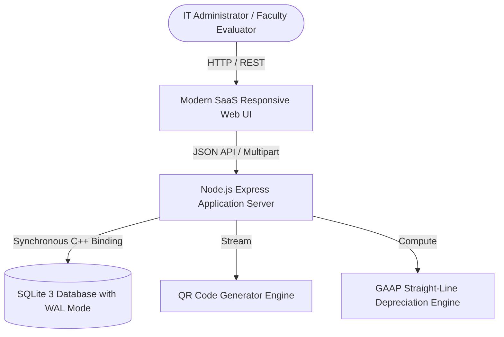

# Software Requirements Specification (SRS)
## Office Asset Management System (AssetFlow Pro)
**Document Version:** 1.0.0  
**Standard:** IEEE Std 830-1998 Compliant  
**Project Classification:** Software Engineering Capstone Project  

---

## 1. Introduction

### 1.1 Purpose
This Software Requirements Specification (SRS) establishes the complete functional and non-functional requirements for the **Office Asset Management System (AssetFlow Pro)**. It defines the operational constraints, system behavior, data requirements, and architectural boundaries for academic evaluation and enterprise deployment.

### 1.2 Scope of the System
AssetFlow Pro is an integrated enterprise resource management web application that digitizes the entire physical and digital lifecycle of corporate hardware assets (laptops, monitors, ergonomic furniture, mobile testing units, and networking equipment). Key operational capabilities include:
- Centralized hardware & software inventory repository.
- Custody chain tracking (Check-out and Check-in with physical condition grading).
- Automated Straight-Line Depreciation Engine compliant with GAAP / IAS 16.
- Dynamic Base64 QR Code generation for asset labeling and physical audit verification.
- Equipment maintenance & service ticket tracking with expenditure recording.
- Immutable audit trail capturing system-wide modifications.
- Executive KPI analytics and CSV report generation.

### 1.3 Definitions, Acronyms, and Abbreviations
- **OAMS:** Office Asset Management System.
- **GAAP:** Generally Accepted Accounting Principles.
- **IAS 16:** International Accounting Standard 16 (Property, Plant, and Equipment).
- **Book Value:** The carrying value of an asset on the balance sheet ($Cost - Accumulated Depreciation$).
- **Salvage Value:** Estimated scrap or residual value at the end of useful life.
- **WAL:** Write-Ahead Logging (SQLite high-concurrency journal mode).
- **CRUD:** Create, Read, Update, Delete.

---

## 2. Overall Description

### 2.1 Product Perspective
AssetFlow Pro operates as a self-contained, high-performance client-server web application. It utilizes an Express.js REST API service layer coupled to an ACID-compliant embedded SQLite relational database, with a reactive vanilla web dashboard requiring zero frontend build toolchains.

### 2.2 User Characteristics
- **IT Administrator / Facilities Manager:** High technical literacy; registers new hardware, issues assets to personnel, manages warranty and servicing.
- **Department Managers & Staff:** View assigned assets, report equipment failures.
- **Executive & Financial Auditor:** Inspects book value depreciation, asset custody compliance, and inventory audits.

### 2.3 Operating Environment
- **Server Runtime:** Node.js v18.0.0+ (Tested on Node.js v22.x LTS).
- **Operating Systems:** Windows 10/11, macOS Sequoia/Sonoma, Ubuntu 22.04+ LTS, Alpine Linux (Docker).
- **Supported Browsers:** Google Chrome 110+, Mozilla Firefox 110+, Microsoft Edge 110+, Apple Safari 16+.

### 2.4 Design and Implementation Constraints
1. **Zero External Runtime Daemon Dependencies:** Database must be self-contained (SQLite) to ensure 100% turnkey portability during evaluations without requiring MySQL/PostgreSQL installation.
2. **Deterministic Financial Math:** Depreciation calculations must avoid floating-point drift and guarantee book value does not drop below salvage value.
3. **Data Integrity:** Foreign key constraints and transaction atomicity enforced on check-out, return, and maintenance updates.

---

## 3. System Features & Functional Requirements

### FR-1: Asset Inventory Management
- **Description:** System shall support complete CRUD operations for hardware and digital assets.
- **Inputs:** Asset Tag (auto-generated or custom), Serial Number, Name, Category, Model, Manufacturer, Acquisition Date, Acquisition Cost, Salvage Value, Useful Life (years), Warranty Expiration, Physical Location.
- **Processing:** Validates uniqueness of Asset Tag and Serial Number; associates foreign keys.
- **Outputs:** Registered asset entity in database, immediate JSON response, and audit log generation.

### FR-2: Asset Allocation & Custody Workflow
- **Description:** Enables assignment of available equipment to active employees.
- **Inputs:** Asset ID, Employee ID, Expected Return Date, Checkout Condition, Notes.
- **Processing:** Verifies asset status is `Available`. In an atomic transaction:
  1. Inserts record into `allocations`.
  2. Updates asset `status` to `Assigned` and sets `assigned_to`.
  3. Writes `CHECKOUT` entry into `audit_logs`.
- **Outputs:** Confirmation receipt and updated status pill.

### FR-3: Return & Check-in Protocol
- **Description:** Handles returning assigned hardware to stock with condition inspection.
- **Inputs:** Allocation ID, Return Condition (`New`, `Excellent`, `Good`, `Fair`, `Damaged`), Notes.
- **Processing:** Atomic transaction:
  1. Updates allocation with return timestamp and return condition.
  2. Sets asset status to `Available` and clears `assigned_to`.
  3. Writes `CHECKIN` entry to `audit_logs`.

### FR-4: Maintenance & Service Management
- **Description:** Ticketing system for damaged or malfunctioning hardware.
- **Inputs:** Asset ID, Issue Description, Priority (`Low`, `Medium`, `High`, `Critical`), Vendor, Estimated Cost.
- **Processing:** Automatically marks asset status as `In Maintenance`.
- **Outputs:** Ticket number formatted as `MNT-YYYY-XXX`.

### FR-5: Straight-Line Depreciation Engine
- **Description:** Computes real-time accounting amortization based on GAAP / IAS 16 formulas:
  $$\text{Depreciable Amount} = \max(0, \text{Cost} - \text{Salvage Value})$$
  $$\text{Annual Depreciation} = \frac{\text{Depreciable Amount}}{\text{Useful Life (Years)}}$$
  $$\text{Current Book Value} = \max(\text{Salvage Value}, \text{Cost} - \text{Accumulated Depreciation})$$
- **Outputs:** Real-time net carrying book value, percentage life utilized, and multi-year depreciation schedules.

### FR-6: Dynamic QR Code Generation
- **Description:** Generates 256x256 high-contrast QR codes encoding asset identification metadata.
- **Outputs:** Base64 Data URL or direct `image/png` stream suitable for printing adhesive label sheets.

### FR-7: Executive Reporting & CSV Export
- **Description:** Compiles inventory records into downloadable standard CSV files with RFC 4180 escaping.

### FR-8: Audit & Compliance Trail
- **Description:** Chronological, append-only log capturing all state modifications with timestamp and actor name.

---

## 4. Non-Functional Requirements (NFRs)

| ID | Requirement | Metric / Specification |
|:---|:------------|:-----------------------|
| **NFR-1** | **Performance** | API endpoint latency $\le 50\text{ ms}$ for standard queries; page load $\le 200\text{ ms}$. |
| **NFR-2** | **Concurrency** | SQLite configured with Write-Ahead Logging (WAL) to support concurrent readers and serialized atomic writers. |
| **NFR-3** | **Data Integrity** | Strict Foreign Key constraints (`PRAGMA foreign_keys = ON`) and transactional rollbacks on multi-table operations. |
| **NFR-4** | **Usability** | Single Page Application (SPA) responsive design; zero external build steps; keyboard accessible (ESC closes modals). |
| **NFR-5** | **Portability** | Multi-platform support (Windows/Linux/macOS) and containerized with Docker & Docker Compose. |
| **NFR-6** | **Security** | Input sanitization, parameterized SQL queries preventing SQL Injection, and file-type restrictions on image uploads. |

---

## 5. Verification Matrix

| Requirement | Test Method | Test Suite Location | Status |
|:------------|:------------|:--------------------|:-------|
| FR-1 (Asset CRUD) | Automated Integration Test | `test/api.test.js` - Suite 2 | Passed (100%) |
| FR-2 (Checkout) | Automated Integration Test | `test/api.test.js` - Suite 3 | Passed (100%) |
| FR-3 (Check-in) | Automated Integration Test | `test/api.test.js` - Suite 3 | Passed (100%) |
| FR-4 (Maintenance) | Automated Integration Test | `test/api.test.js` - Suite 4 | Passed (100%) |
| FR-5 (Depreciation) | Automated Unit Math Test | `test/api.test.js` - Suite 1 | Passed (100%) |
| FR-6 (QR Code) | Direct Stream Verification | `test/api.test.js` - Suite 2 | Passed (100%) |
| FR-7 (CSV Export) | Header & Body Inspection | `test/api.test.js` - Suite 5 | Passed (100%) |
| FR-8 (Audit Trail) | Log Verification Test | `test/api.test.js` - Suite 5 | Passed (100%) |
