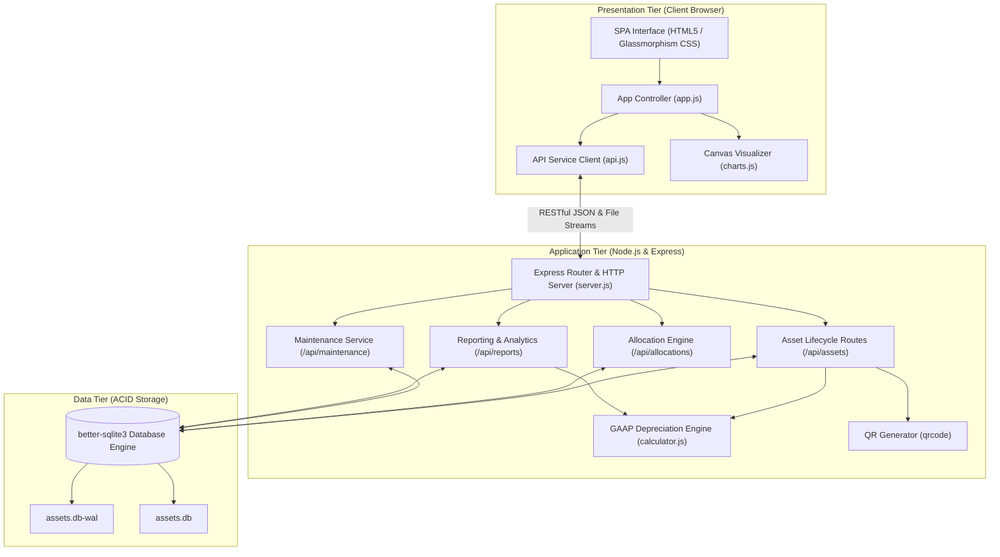
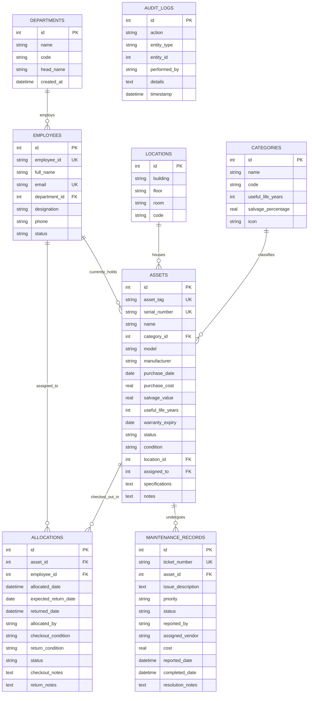
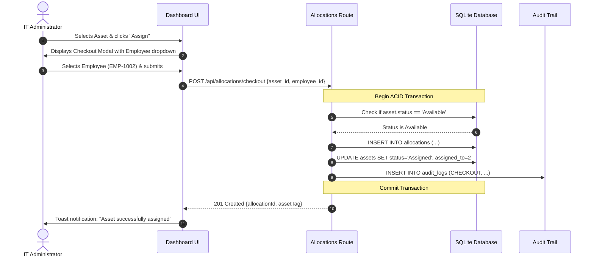
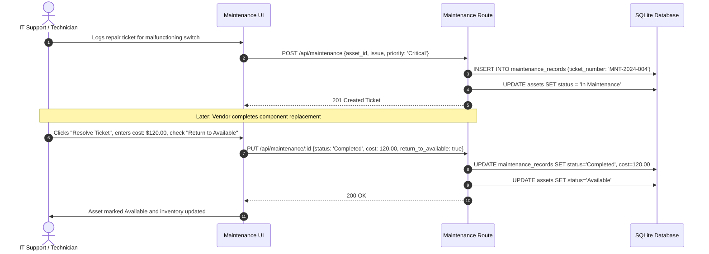

# System Design Document (SDD)
## Office Asset Management System (AssetFlow Pro)
**Document Version:** 1.0.0  
**Project Classification:** Software Engineering Architecture Specification  

---

## 1. System Architecture

AssetFlow Pro follows a classic **Layered 3-Tier Client-Server Architecture** designed for high throughput, zero configuration overhead, and deterministic execution.

---

## 2. Entity-Relationship Diagram (ERD)

The database schema is normalized to **Third Normal Form (3NF)** with strict foreign key constraints and indexed columns for fast lookup.

---

## 3. Sequence Diagrams

### 3.1 Asset Allocation / Check-out Sequence

### 3.2 Equipment Maintenance & Repair Lifecycle

---

## 4. RESTful API Specification

| Endpoint | Method | Description | Request Body / Query | Success Response |
|:---------|:-------|:------------|:---------------------|:-----------------|
| `/api/reports/dashboard` | `GET` | Aggregated executive KPIs | None | `{ summary, categoryDistribution, ... }` |
| `/api/assets` | `GET` | Filtered asset list | `status, category_id, search` | `{ count, data: [ ...assets with financials ] }` |
| `/api/assets/:id` | `GET` | Asset details, QR, history | None | `{ data: { ...asset, financials, qrCodeDataUrl } }` |
| `/api/assets/:id/qr` | `GET` | Stream QR Code image | None | Binary `image/png` stream |
| `/api/assets` | `POST` | Register new asset | JSON asset schema | `201 Created { id, asset_tag }` |
| `/api/assets/:id` | `PUT` | Update asset attributes | JSON fields | `200 OK { message }` |
| `/api/allocations` | `GET` | List custody records | `status: 'Active' / 'ALL'` | `{ count, data: [ ...allocations ] }` |
| `/api/allocations/checkout` | `POST` | Check-out equipment | `{ asset_id, employee_id }` | `201 Created { allocationId }` |
| `/api/allocations/checkin` | `POST` | Return equipment | `{ allocation_id, return_condition }`| `200 OK { message }` |
| `/api/maintenance` | `GET` | List service tickets | `status, priority` | `{ count, data: [ ...tickets ] }` |
| `/api/maintenance` | `POST` | Open service ticket | `{ asset_id, issue, priority }` | `201 Created { ticketNumber }` |
| `/api/maintenance/:id` | `PUT` | Resolve service ticket | `{ status, cost, notes }` | `200 OK { message }` |
| `/api/reports/depreciation`| `GET` | Straight-Line valuation table | None | `{ count, data: [ ...depreciation ] }` |
| `/api/reports/export-csv` | `GET` | Downloadable CSV Register | None | `text/csv` attachment |
| `/api/audit` | `GET` | Compliance audit log | `limit` (default 100) | `{ count, data: [ ...audit logs ] }` |
